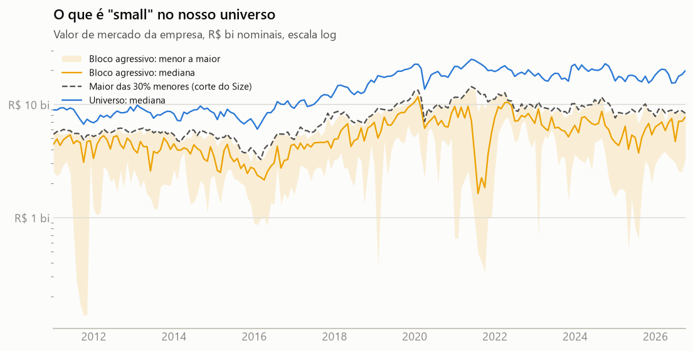

# Diagnóstico do bloco agressivo (sequencial)

Gerado por `python src/diagnostico.py sequencial`. Período 03/01/2011 a 23/10/2026; custo principal 0,2% por operação. Nada aqui muda a estratégia.

## 1. Contribuição por ação

| medida | valor |
|---|---|
| ações diferentes que passaram pelo bloco | 121 |
| soma das contribuições (antes do custo) | 117,9% |
| soma dos custos | −28,9% |
| soma das contribuições positivas | 334,1% |
| soma das contribuições negativas | −216,2% |
| 15 maiores / positivas | 53,8% |
| 15 menores / negativas | 66,7% |
| 5 menores / negativas | 31,5% |
| ações com contribuição negativa | 52 de 121 |
| meses na carteira por ação (mediana) | 7 |
| das 15 menores, quantas pararam de negociar | 3 |
| das 15 maiores, quantas pararam de negociar | 4 |

### 15 menores

| ticker | contribuição | meses | retorno médio no mês | na carteira | situação | 12m antes de sair |
|---|---|---|---|---|---|---|
| MNDL4 | −17,2% | 4 | −25,6% | 06/2011–09/2011 | troca de código → MNDL3 (03/2012) | 22,6% |
| CASH3 | −15,0% | 7 | −15,0% | 08/2021–07/2025 | ativa | — |
| GFSA3 | −12,2% | 12 | −7,1% | 05/2013–01/2023 | ativa | — |
| SEER3 | −12,0% | 7 | −11,0% | 01/2015–03/2018 | ativa | — |
| RAPT4 | −11,6% | 15 | −5,5% | 03/2011–12/2020 | ativa | — |
| LIGT3 | −9,4% | 28 | −2,3% | 05/2011–07/2023 | ativa | — |
| ETER3 | −8,9% | 5 | −10,9% | 12/2020–07/2021 | ativa | — |
| BEEF3 | −8,8% | 45 | −1,4% | 02/2013–11/2025 | ativa | — |
| ELPL4 | −8,6% | 12 | −4,7% | 08/2011–11/2017 | troca de código → ELPL3 (11/2017) | 68,8% |
| VIVR3 | −8,1% | 3 | −18,1% | 07/2021–09/2021 | ativa | — |
| ENAT3 | −7,5% | 14 | −3,8% | 01/2016–07/2024 | saiu da bolsa (07/2024) | 58,2% |
| AUAU3 | −7,2% | 6 | −8,4% | 08/2021–01/2025 | ativa | — |
| WIZC3 | −6,9% | 6 | −7,9% | 06/2017–09/2021 | ativa | — |
| SBFG3 | −6,0% | 8 | −5,2% | 02/2020–09/2020 | ativa | — |
| POSI3 | −4,9% | 6 | −5,8% | 05/2021–10/2021 | ativa | — |

### 15 maiores

| ticker | contribuição | meses | retorno médio no mês | na carteira | situação | 12m antes de sair |
|---|---|---|---|---|---|---|
| MGLU3 | 30,7% | 12 | 17,9% | 07/2014–06/2017 | ativa | — |
| CSMG3 | 18,8% | 29 | 4,5% | 01/2012–04/2025 | ativa | — |
| CVCB3 | 13,6% | 21 | 4,2% | 04/2016–04/2025 | ativa | — |
| DIRR3 | 13,4% | 24 | 3,9% | 08/2023–03/2026 | ativa | — |
| CURY3 | 12,6% | 14 | 6,3% | 09/2024–09/2026 | ativa | — |
| SAUD3 | 12,2% | 24 | 3,4% | 12/2010–03/2018 | ativa | — |
| GOLL54 | 9,9% | 40 | 1,5% | 05/2013–07/2023 | saiu da bolsa (03/2026) | −99,2% |
| CESP6 | 9,9% | 11 | 6,2% | 09/2018–02/2021 | saiu da bolsa (03/2022) | −2,3% |
| ENEV3 | 9,7% | 13 | 5,3% | 03/2011–10/2019 | ativa | — |
| HGTX3 | 8,9% | 24 | 2,2% | 12/2010–06/2021 | saiu da bolsa (09/2021) | 102,4% |
| BIDI4 | 8,1% | 3 | 18,8% | 04/2019–06/2019 | saiu da bolsa (06/2022) | −84,0% |
| QUAL3 | 8,1% | 24 | 2,4% | 05/2012–10/2020 | ativa | — |
| EQTL3 | 8,1% | 23 | 2,5% | 01/2013–01/2015 | ativa | — |
| BRAP4 | 8,0% | 22 | 2,6% | 11/2016–09/2026 | ativa | — |
| AMBP3 | 7,9% | 5 | 11,1% | 08/2021–08/2024 | ativa | — |

## 2. Size e Momentum separados (mesmo universo, mesmo custo, mensal)

| série | custo | CAGR | Volatilidade | Sharpe (CDI) | Max drawdown | Alpha | Beta |
|---|---|---|---|---|---|---|---|
| Universo peso igual | custo 0,2% | 6,45% | 22,7% | −0,03 | −49,0% | −0,71% | 0,92 |
| Só Size (30% menores) | custo 0,2% | −1,91% | 29,1% | −0,25 | −72,3% | −7,34% | 1,06 |
| Só Momentum (30% maiores) | custo 0,2% | 11,13% | 22,8% | 0,16 | −52,4% | 3,70% | 0,84 |
| Bloco agressivo | custo 0,2% | 1,41% | 30,4% | −0,12 | −64,1% | −3,54% | 0,94 |
| Ibovespa | custo 0,2% | 7,11% | 23,1% | 0,00 | −47,7% | 0,00% | 1,00 |
| CDI | custo 0,2% | 9,93% | 0,2% | — | 0,0% | 0,00% | −0,00 |
| Universo peso igual | sem custo | 6,79% | 22,7% | −0,02 | −48,9% | −0,39% | 0,92 |
| Só Size (30% menores) | sem custo | −1,12% | 29,1% | −0,22 | −71,2% | −6,53% | 1,06 |
| Só Momentum (30% maiores) | sem custo | 12,39% | 22,8% | 0,21 | −52,4% | 4,85% | 0,84 |
| Bloco agressivo | sem custo | 3,28% | 30,4% | −0,05 | −62,1% | −1,68% | 0,94 |
| Ibovespa | sem custo | 7,11% | 23,1% | 0,00 | −47,7% | 0,00% | 1,00 |

| variante | ações por carteira | giro médio por mês |
|---|---|---|
| Universo peso igual | 86 | 13% |
| Só Size (30% menores) | 25 | 33% |
| Só Momentum (30% maiores) | 25 | 47% |
| Bloco agressivo | 7 | 76% |

## 3. O que é "small" no nosso universo (R$ bi nominais)

| R$ bi | universo_mediana | menores30_mediana | menores30_maior | bloco_mediana | bloco_menor | bloco_maior |
|---|---|---|---|---|---|---|
| período todo (média das datas) | 14,4 | 5,1 | 7,9 | 5,5 | 2,8 | 7,5 |
| 2023-26 | 19,2 | 5,7 | 9,4 | 6,3 | 3,0 | 8,9 |
| última data (09/2026) | 21,9 | 5,2 | 8,5 | 7,8 | 3,3 | 8,5 |

| ano (média, R$ bi) | universo_mediana | menores30_mediana | menores30_maior | bloco_mediana | bloco_menor | bloco_maior |
|---|---|---|---|---|---|---|
| 2010 | 8,9 | 3,9 | 5,4 | 4,4 | 2,5 | 5,4 |
| 2011 | 8,2 | 3,8 | 5,5 | 4,5 | 1,7 | 5,4 |
| 2012 | 8,3 | 3,6 | 5,8 | 4,7 | 2,2 | 5,6 |
| 2013 | 8,6 | 3,7 | 5,8 | 4,1 | 1,8 | 5,7 |
| 2014 | 8,7 | 3,9 | 5,6 | 4,1 | 2,1 | 5,2 |
| 2015 | 8,1 | 2,9 | 4,7 | 3,2 | 1,9 | 4,4 |
| 2016 | 9,0 | 2,9 | 4,8 | 3,1 | 1,4 | 4,5 |
| 2017 | 11,0 | 4,6 | 6,6 | 4,5 | 2,7 | 5,9 |
| 2018 | 14,0 | 5,4 | 7,7 | 5,7 | 2,9 | 7,4 |
| 2019 | 19,2 | 7,6 | 10,1 | 7,8 | 4,1 | 9,5 |
| 2020 | 18,6 | 7,5 | 10,0 | 7,8 | 4,1 | 9,8 |
| 2021 | 22,0 | 7,3 | 12,2 | 5,6 | 1,3 | 11,3 |
| 2022 | 19,6 | 6,1 | 10,4 | 8,5 | 5,9 | 10,2 |
| 2023 | 18,2 | 5,4 | 9,3 | 6,4 | 3,6 | 8,8 |
| 2024 | 20,4 | 6,1 | 9,9 | 6,6 | 3,3 | 9,4 |
| 2025 | 17,5 | 5,7 | 9,1 | 5,3 | 1,9 | 8,7 |
| 2026 | 21,3 | 5,6 | 9,1 | 7,1 | 3,5 | 8,8 |

## 4. Concentração e diversificação

| medida | Bloco agressivo | Só Size (30% menores) | Só Momentum (30% maiores) | Universo peso igual |
|---|---|---|---|---|
| ações por carteira (média) | 6,9 | 25,1 | 24,7 | 85,5 |
| mín | 6 | 24 | 23 | 83 |
| máx | 7 | 26 | 26 | 87 |
| vol. média das ações | 47,7% | 51,8% | 40,4% | 42,4% |
| vol. da carteira | 30,3% | 29,0% | 22,7% | 22,6% |
| carteira / ações | 0,64 | 0,56 | 0,56 | 0,53 |
| correlação média implícita | 0,30 | 0,28 | 0,29 | 0,28 |
| R² diário contra o universo | 0,66 | 0,90 | 0,82 | 1,00 |
| risco específico (1 − R²) | 34,0% | 9,5% | 18,1% | 0,0% |

## 5. Por período

| ano | Bloco agressivo | Universo peso igual | Só Size (30% menores) | Só Momentum (30% maiores) | Ibovespa | CDI |
|---|---|---|---|---|---|---|
| 2011 | −5,7% | −16,5% | −31,0% | 4,2% | −18,1% | 11,6% |
| 2012 | 37,0% | 16,0% | 11,1% | 23,0% | 7,4% | 8,4% |
| 2013 | −0,7% | −7,4% | −25,1% | 0,9% | −15,5% | 8,1% |
| 2014 | 1,2% | −3,7% | −12,7% | 0,6% | −2,9% | 10,8% |
| 2015 | −30,5% | −15,9% | −30,7% | −6,0% | −13,3% | 13,2% |
| 2016 | 5,0% | 42,7% | 54,3% | 16,6% | 38,9% | 14,0% |
| 2017 | 66,8% | 37,0% | 51,5% | 53,5% | 26,9% | 10,0% |
| 2018 | −13,0% | 13,6% | 8,5% | 5,6% | 15,0% | 6,4% |
| 2019 | 43,3% | 49,0% | 54,7% | 51,7% | 31,9% | 6,0% |
| 2020 | −5,6% | 2,5% | 0,1% | 18,1% | 2,9% | 2,8% |
| 2021 | −23,2% | −15,7% | −25,2% | −9,4% | −12,1% | 4,4% |
| 2022 | 1,9% | −11,7% | −22,3% | −6,9% | 5,0% | 12,4% |
| 2023 | −15,5% | 16,3% | −4,4% | 8,0% | 22,0% | 13,0% |
| 2024 | −25,0% | −21,5% | −37,5% | −3,3% | −10,4% | 10,9% |
| 2025 | 39,7% | 32,2% | 34,5% | 28,0% | 34,0% | 14,3% |
| 2026 | −3,0% | 21,3% | 16,1% | 13,1% | 27,3% | 11,5% |

| subperíodo (CAGR) | Bloco agressivo | Universo peso igual | Só Size (30% menores) | Só Momentum (30% maiores) | Ibovespa | CDI |
|---|---|---|---|---|---|---|
| 2011-14 | 6,8% | −3,6% | −15,9% | 6,8% | −7,9% | 9,7% |
| 2015-16 (recessão) | −14,7% | 9,6% | 3,4% | 4,7% | 9,8% | 13,7% |
| 2017-19 | 27,7% | 32,5% | 36,6% | 35,1% | 24,5% | 7,5% |
| 2020 (Covid) | −5,7% | 2,5% | 0,1% | 18,2% | 2,9% | 2,8% |
| 2021-22 (alta de juros) | −11,7% | −13,8% | −24,0% | −8,2% | −4,0% | 8,4% |
| 2023-26 | −3,9% | 10,6% | −1,8% | 11,5% | 17,8% | 13,1% |

### Piores quedas do bloco

| # | topo | fundo | recuperação | queda do bloco | Universo peso igual no mesmo trecho | Ibovespa no mesmo trecho |
|---|---|---|---|---|---|---|
| 0 | 06/2021 | 06/2024 | não recuperou | −64,1% | −35,4% | −8,4% |
| 1 | 01/2020 | 03/2020 | 05/2021 | −60,2% | −47,1% | −44,0% |
| 2 | 09/2014 | 05/2016 | 03/2017 | −44,9% | −15,9% | −16,0% |
| 3 | 07/2011 | 08/2011 | 11/2012 | −41,8% | −19,6% | −17,6% |
| 4 | 10/2017 | 06/2018 | 08/2019 | −31,7% | −9,2% | −8,6% |

### Momentum crash

| retorno médio mensal | rebote (38 meses) | demais (140 meses) |
|---|---|---|
| Bloco agressivo | 5,18% | −0,75% |
| Só Momentum (30% maiores) | 4,72% | 0,15% |
| Perdedoras de Momentum (30% menores) | 7,90% | −1,87% |
| Momentum − Perdedoras | −3,18% | 2,01% |
| Universo peso igual | 6,09% | −0,55% |
| Ibovespa | 6,03% | −0,47% |

| pior mês | bloco | universo | Ibovespa no mês | Ibovespa 12m antes | Momentum − Perdedoras | rebote? |
|---|---|---|---|---|---|---|
| 03/2020 | −41,5% | −33,2% | −29,9% | 9,0% | −5,8% | não |
| 10/2021 | −24,8% | −10,5% | −6,7% | 17,3% | −6,9% | não |
| 06/2022 | −19,7% | −15,1% | −11,5% | −11,8% | 11,0% | não |
| 05/2018 | −16,6% | −9,8% | −10,9% | 31,7% | −4,8% | não |
| 02/2023 | −15,0% | −10,6% | −7,6% | 1,0% | 10,6% | não |
| 08/2023 | −14,6% | −8,4% | −5,1% | 18,2% | 1,4% | não |
| 07/2011 | −14,0% | −6,9% | −5,7% | — | 4,1% | não |
| 09/2021 | −13,8% | −5,9% | −6,6% | 19,5% | −0,9% | não |
| 01/2024 | −12,7% | −7,0% | −4,8% | 22,0% | 2,3% | não |
| 12/2024 | −12,2% | −8,1% | −4,3% | −1,3% | 8,3% | não |

## 6. Giro e custo

| medida | valor |
|---|---|
| CAGR sem custo | 3,28% |
| CAGR com custo | 1,41% |
| perda de CAGR pelo custo | 1,87% |
| custo pago por ano (soma simples) | 1,83% |
| custo acumulado (composto) | 25,1% |
| distância até o CDI (com custo) | 8,52% |
| parte dessa distância explicada pelo custo | 22% |
| distância até o universo peso igual (ambos com custo) | 5,04% |
| parte dessa distância explicada pelo custo extra | 31% |

## 7. Papel do bloco agressivo na carteira

| série | CAGR | Volatilidade | Sharpe (CDI) | Max drawdown | Alpha | Beta |
|---|---|---|---|---|---|---|
| Estratégia 65/35 | 8,96% | 21,3% | 0,06 | −44,2% | 1,34% | 0,81 |
| Bloco defensivo | 12,30% | 19,5% | 0,21 | −37,9% | 4,04% | 0,74 |
| Bloco agressivo | 1,41% | 30,4% | −0,12 | −64,1% | −3,54% | 0,94 |
| 65% defensivo + 35% CDI (referência) | 11,93% | 12,6% | 0,21 | −25,3% | 2,60% | 0,47 |
| Ibovespa | 7,11% | 23,1% | 0,00 | −47,7% | 0,00% | 1,00 |
| CDI | 9,93% | 0,2% | — | 0,0% | 0,00% | −0,00 |

|  | correlação agressivo × defensivo |
|---|---|
| diária, período todo | 0,67 |
| mensal, período todo | 0,66 |
| diária, 2011-14 | 0,57 |
| diária, 2015-16 (recessão) | 0,66 |
| diária, 2017-19 | 0,65 |
| diária, 2020 (Covid) | 0,83 |
| diária, 2021-22 (alta de juros) | 0,60 |
| diária, 2023-26 | 0,68 |

### Piores quedas da carteira e o que cada bloco fez no mesmo trecho

| # | topo | fundo | carteira 65/35 | só defensivo, mesmo trecho | só agressivo, mesmo trecho |
|---|---|---|---|---|---|
| 0 | 01/2020 | 03/2020 | −44,2% | −36,9% | −56,3% |
| 1 | 09/2014 | 01/2016 | −31,3% | −24,8% | −43,6% |
| 2 | 07/2011 | 08/2011 | −24,2% | −12,1% | −41,8% |
| 3 | 03/2018 | 06/2018 | −23,9% | −20,0% | −31,1% |
| 4 | 04/2026 | 08/2026 | −20,9% | −16,1% | −29,3% |

| subperíodo | vol. carteira 65/35 | vol. só defensivo |
|---|---|---|
| 2011-14 | 17,8% | 17,9% |
| 2015-16 (recessão) | 20,2% | 20,6% |
| 2017-19 | 17,7% | 16,1% |
| 2020 (Covid) | 44,0% | 38,3% |
| 2021-22 (alta de juros) | 21,9% | 19,4% |
| 2023-26 | 17,9% | 15,1% |

