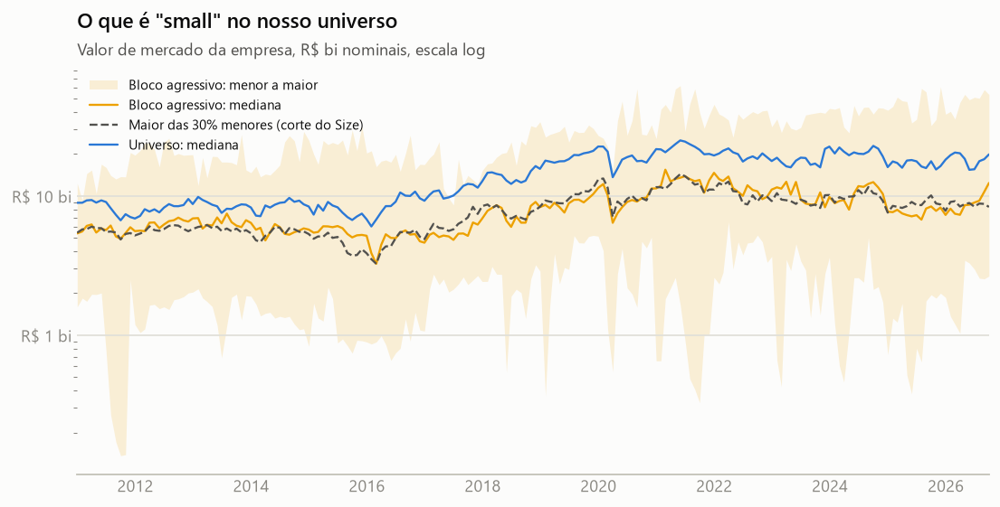

# Diagnóstico do bloco agressivo (interseccional)

Gerado por `python src/diagnostico.py interseccional`. Período 03/01/2011 a 23/10/2026; custo principal 0,2% por operação. Nada aqui muda a estratégia.

## 1. Contribuição por ação

| medida | valor |
|---|---|
| ações diferentes que passaram pelo bloco | 175 |
| soma das contribuições (antes do custo) | 184,5% |
| soma dos custos | −17,8% |
| soma das contribuições positivas | 282,8% |
| soma das contribuições negativas | −98,3% |
| 15 maiores / positivas | 39,4% |
| 15 menores / negativas | 59,9% |
| 5 menores / negativas | 29,3% |
| ações com contribuição negativa | 55 de 175 |
| meses na carteira por ação (mediana) | 20 |
| das 15 menores, quantas pararam de negociar | 4 |
| das 15 maiores, quantas pararam de negociar | 1 |

### 15 menores

| ticker | contribuição | meses | retorno médio no mês | na carteira | situação | 12m antes de sair |
|---|---|---|---|---|---|---|
| AZUL54 | −7,8% | 30 | −6,4% | 03/2018–04/2024 | troca de código → AZUL3 (01/2026) | −99,9% |
| GFSA3 | −7,4% | 40 | −4,6% | 12/2012–03/2024 | ativa | — |
| CASH3 | −5,0% | 8 | −15,5% | 08/2021–07/2025 | ativa | — |
| MNDL4 | −4,5% | 5 | −21,7% | 06/2011–10/2011 | troca de código → MNDL3 (03/2012) | 22,6% |
| AUAU3 | −4,0% | 13 | −7,6% | 07/2021–01/2025 | ativa | — |
| LIGT3 | −4,0% | 68 | −1,5% | 01/2011–07/2023 | ativa | — |
| RAPT4 | −3,8% | 34 | −2,7% | 01/2011–12/2020 | ativa | — |
| SOMA3 | −3,7% | 11 | −8,3% | 09/2021–07/2023 | saiu da bolsa (07/2024) | −47,1% |
| PCAR3 | −3,6% | 20 | −4,5% | 03/2022–12/2025 | ativa | — |
| ENAT3 | −3,1% | 17 | −4,6% | 01/2012–07/2024 | saiu da bolsa (07/2024) | 58,2% |
| RECV3 | −2,7% | 22 | −3,0% | 07/2022–05/2026 | ativa | — |
| WIZC3 | −2,6% | 9 | −6,8% | 04/2017–09/2021 | ativa | — |
| ANIM3 | −2,3% | 8 | −7,2% | 08/2014–08/2015 | ativa | — |
| SEER3 | −2,3% | 9 | −6,1% | 01/2015–03/2018 | ativa | — |
| ETER3 | −2,3% | 5 | −10,9% | 12/2020–07/2021 | ativa | — |

### 15 maiores

| ticker | contribuição | meses | retorno médio no mês | na carteira | situação | 12m antes de sair |
|---|---|---|---|---|---|---|
| MGLU3 | 15,4% | 33 | 11,6% | 07/2014–02/2026 | ativa | — |
| PRIO3 | 9,3% | 51 | 4,6% | 08/2011–09/2026 | ativa | — |
| CSMG3 | 8,4% | 69 | 3,0% | 01/2012–09/2026 | ativa | — |
| BRAP4 | 8,1% | 87 | 2,3% | 08/2016–09/2026 | ativa | — |
| ENEV3 | 8,0% | 60 | 3,3% | 12/2010–09/2026 | ativa | — |
| EMBJ3 | 7,3% | 59 | 3,1% | 12/2010–08/2025 | ativa | — |
| CYRE3 | 7,3% | 99 | 1,8% | 03/2012–07/2026 | ativa | — |
| CPLE6 | 6,9% | 68 | 2,5% | 11/2013–04/2025 | troca de código → CPLE3 (11/2025) | 55,3% |
| RADL3 | 6,7% | 43 | 3,9% | 08/2011–05/2026 | ativa | — |
| IRBR3 | 6,7% | 41 | 4,1% | 05/2018–09/2026 | ativa | — |
| TAEE11 | 6,2% | 80 | 1,9% | 09/2012–09/2026 | ativa | — |
| FLRY3 | 5,7% | 62 | 2,3% | 04/2016–09/2026 | ativa | — |
| MOVI3 | 5,4% | 22 | 6,2% | 08/2019–09/2026 | ativa | — |
| MRVE3 | 5,0% | 103 | 1,2% | 12/2010–07/2026 | ativa | — |
| EQTL3 | 4,8% | 50 | 2,4% | 01/2013–08/2023 | ativa | — |

## 2. Size e Momentum separados (mesmo universo, mesmo custo, mensal)

| série | custo | CAGR | Volatilidade | Sharpe (CDI) | Max drawdown | Alpha | Beta |
|---|---|---|---|---|---|---|---|
| Universo peso igual | custo 0,2% | 6,66% | 22,7% | −0,02 | −49,0% | −0,50% | 0,92 |
| Só Size (30% menores) | custo 0,2% | −1,15% | 29,1% | −0,22 | −69,0% | −6,57% | 1,06 |
| Só Momentum (30% maiores) | custo 0,2% | 10,98% | 22,8% | 0,16 | −52,4% | 3,56% | 0,84 |
| Bloco agressivo sequencial (Entrega 1) | custo 0,2% | 1,89% | 30,3% | −0,10 | −64,1% | −3,07% | 0,94 |
| Bloco agressivo | custo 0,2% | 7,77% | 24,1% | 0,04 | −55,7% | 0,91% | 0,89 |
| Ibovespa | custo 0,2% | 7,11% | 23,1% | 0,00 | −47,7% | 0,00% | 1,00 |
| CDI | custo 0,2% | 9,93% | 0,2% | — | 0,0% | 0,00% | −0,00 |
| Universo peso igual | sem custo | 6,99% | 22,7% | −0,01 | −48,9% | −0,19% | 0,92 |
| Só Size (30% menores) | sem custo | −0,36% | 29,1% | −0,20 | −68,2% | −5,76% | 1,06 |
| Só Momentum (30% maiores) | sem custo | 12,24% | 22,8% | 0,21 | −52,4% | 4,71% | 0,84 |
| Bloco agressivo sequencial (Entrega 1) | sem custo | 3,76% | 30,3% | −0,04 | −62,1% | −1,23% | 0,94 |
| Bloco agressivo | sem custo | 8,99% | 24,1% | 0,09 | −55,7% | 2,05% | 0,89 |
| Ibovespa | sem custo | 7,11% | 23,1% | 0,00 | −47,7% | 0,00% | 1,00 |

| variante | ações por carteira | giro médio por mês |
|---|---|---|
| Universo peso igual | 86 | 12% |
| Só Size (30% menores) | 25 | 33% |
| Só Momentum (30% maiores) | 25 | 47% |
| Bloco agressivo sequencial (Entrega 1) | 7 | 75% |
| Bloco agressivo | 25 | 46% |

## 3. O que é "small" no nosso universo (R$ bi nominais)

| R$ bi | universo_mediana | menores30_mediana | menores30_maior | bloco_mediana | bloco_menor | bloco_maior |
|---|---|---|---|---|---|---|
| período todo (média das datas) | 14,2 | 5,1 | 7,8 | 8,0 | 2,0 | 28,7 |
| 2023-26 | 18,5 | 5,6 | 9,2 | 9,3 | 2,0 | 42,0 |
| última data (09/2026) | 19,9 | 5,0 | 8,3 | 12,4 | 2,7 | 53,5 |

| ano (média, R$ bi) | universo_mediana | menores30_mediana | menores30_maior | bloco_mediana | bloco_menor | bloco_maior |
|---|---|---|---|---|---|---|
| 2010 | 8,9 | 3,9 | 5,4 | 5,4 | 1,6 | 12,3 |
| 2011 | 8,2 | 4,0 | 5,6 | 5,7 | 1,2 | 14,8 |
| 2012 | 8,3 | 3,6 | 5,8 | 6,4 | 1,6 | 21,3 |
| 2013 | 8,6 | 3,7 | 5,8 | 6,5 | 1,6 | 17,5 |
| 2014 | 8,6 | 3,8 | 5,4 | 5,6 | 1,3 | 19,9 |
| 2015 | 7,7 | 2,7 | 4,6 | 5,6 | 1,2 | 23,4 |
| 2016 | 8,9 | 2,9 | 4,7 | 4,8 | 1,0 | 18,5 |
| 2017 | 11,0 | 4,6 | 6,6 | 5,5 | 2,4 | 14,8 |
| 2018 | 14,0 | 5,4 | 7,7 | 7,6 | 2,3 | 23,3 |
| 2019 | 19,2 | 7,6 | 10,1 | 9,1 | 3,7 | 28,7 |
| 2020 | 18,6 | 7,5 | 10,0 | 9,5 | 2,8 | 31,7 |
| 2021 | 22,0 | 7,3 | 12,2 | 13,1 | 1,3 | 44,6 |
| 2022 | 19,6 | 6,1 | 10,4 | 11,3 | 4,1 | 36,9 |
| 2023 | 18,2 | 5,4 | 9,3 | 10,2 | 2,5 | 35,7 |
| 2024 | 20,4 | 6,1 | 9,9 | 10,3 | 1,9 | 40,0 |
| 2025 | 17,1 | 5,5 | 8,7 | 7,6 | 1,3 | 45,2 |
| 2026 | 18,4 | 5,4 | 8,7 | 9,0 | 2,3 | 48,8 |

## 4. Concentração e diversificação

| medida | Bloco agressivo | Só Size (30% menores) | Só Momentum (30% maiores) | Universo peso igual |
|---|---|---|---|---|
| ações por carteira (média) | 24,7 | 25,1 | 24,7 | 85,5 |
| mín | 23 | 24 | 23 | 83 |
| máx | 26 | 26 | 26 | 87 |
| vol. média das ações | 42,6% | 51,6% | 40,3% | 42,3% |
| vol. da carteira | 24,0% | 29,0% | 22,7% | 22,7% |
| carteira / ações | 0,56 | 0,56 | 0,56 | 0,54 |
| correlação média implícita | 0,29 | 0,29 | 0,29 | 0,28 |
| R² diário contra o universo | 0,88 | 0,91 | 0,82 | 1,00 |
| risco específico (1 − R²) | 12,0% | 9,5% | 18,1% | 0,0% |

## 5. Por período

| ano | Bloco agressivo | Universo peso igual | Só Size (30% menores) | Só Momentum (30% maiores) | Ibovespa | CDI |
|---|---|---|---|---|---|---|
| 2011 | −7,5% | −13,8% | −23,3% | 3,6% | −18,1% | 11,6% |
| 2012 | 24,6% | 16,0% | 11,1% | 23,0% | 7,4% | 8,4% |
| 2013 | −6,2% | −7,4% | −25,1% | 0,9% | −15,5% | 8,1% |
| 2014 | 3,3% | −3,7% | −12,1% | 1,4% | −2,9% | 10,8% |
| 2015 | −8,8% | −15,7% | −29,5% | −5,8% | −13,3% | 13,2% |
| 2016 | 22,3% | 43,0% | 52,0% | 18,6% | 38,9% | 14,0% |
| 2017 | 65,8% | 37,0% | 51,5% | 53,5% | 26,9% | 10,0% |
| 2018 | 2,7% | 13,6% | 8,5% | 5,6% | 15,0% | 6,4% |
| 2019 | 58,3% | 49,0% | 54,7% | 51,7% | 31,9% | 6,0% |
| 2020 | −3,7% | 2,5% | 0,1% | 18,1% | 2,9% | 2,8% |
| 2021 | −14,8% | −15,7% | −25,2% | −9,4% | −12,1% | 4,4% |
| 2022 | −10,5% | −11,7% | −22,3% | −6,9% | 5,0% | 12,4% |
| 2023 | 9,6% | 16,3% | −4,4% | 8,0% | 22,0% | 13,0% |
| 2024 | −20,7% | −21,5% | −37,5% | −3,3% | −10,4% | 10,9% |
| 2025 | 31,7% | 31,6% | 34,4% | 25,4% | 34,0% | 14,3% |
| 2026 | 15,6% | 21,0% | 16,7% | 10,8% | 27,3% | 11,5% |

| subperíodo (CAGR) | Bloco agressivo | Universo peso igual | Só Size (30% menores) | Só Momentum (30% maiores) | Ibovespa | CDI |
|---|---|---|---|---|---|---|
| 2011-14 | 2,8% | −2,8% | −13,5% | 6,9% | −7,9% | 9,7% |
| 2015-16 (recessão) | 5,7% | 9,8% | 3,5% | 5,7% | 9,8% | 13,7% |
| 2017-19 | 39,3% | 32,5% | 36,6% | 35,1% | 24,5% | 7,5% |
| 2020 (Covid) | −3,7% | 2,5% | 0,1% | 18,2% | 2,9% | 2,8% |
| 2021-22 (alta de juros) | −12,8% | −13,8% | −24,0% | −8,2% | −4,0% | 8,4% |
| 2023-26 | 7,6% | 10,4% | −1,7% | 10,3% | 17,8% | 13,1% |

### Piores quedas do bloco

| # | topo | fundo | recuperação | queda do bloco | Universo peso igual no mesmo trecho | Ibovespa no mesmo trecho |
|---|---|---|---|---|---|---|
| 0 | 01/2020 | 03/2020 | 05/2021 | −55,7% | −47,1% | −44,0% |
| 1 | 06/2021 | 06/2024 | não recuperou | −49,5% | −35,4% | −8,4% |
| 2 | 09/2014 | 01/2016 | 07/2016 | −26,4% | −37,5% | −39,1% |
| 3 | 06/2011 | 08/2011 | 02/2012 | −24,7% | −24,0% | −24,4% |
| 4 | 02/2018 | 06/2018 | 01/2019 | −23,5% | −16,4% | −20,4% |

### Momentum crash

| retorno médio mensal | rebote (38 meses) | demais (140 meses) |
|---|---|---|
| Bloco agressivo | 5,49% | −0,26% |
| Só Momentum (30% maiores) | 4,76% | 0,12% |
| Perdedoras de Momentum (30% menores) | 7,89% | −1,86% |
| Momentum − Perdedoras | −3,13% | 1,99% |
| Universo peso igual | 6,10% | −0,55% |
| Ibovespa | 6,03% | −0,47% |

| pior mês | bloco | universo | Ibovespa no mês | Ibovespa 12m antes | Momentum − Perdedoras | rebote? |
|---|---|---|---|---|---|---|
| 03/2020 | −40,5% | −33,2% | −29,9% | 9,0% | −5,8% | não |
| 10/2021 | −17,8% | −10,5% | −6,7% | 17,3% | −6,9% | não |
| 06/2022 | −15,2% | −15,1% | −11,5% | −11,8% | 11,0% | não |
| 05/2018 | −14,0% | −9,8% | −10,9% | 31,7% | −4,8% | não |
| 08/2023 | −13,2% | −8,4% | −5,1% | 18,2% | 1,4% | não |
| 06/2013 | −10,7% | −9,0% | −11,3% | −1,8% | 3,4% | não |
| 02/2023 | −10,7% | −10,6% | −7,6% | 1,0% | 10,6% | não |
| 09/2014 | −9,9% | −8,8% | −11,7% | 22,6% | −2,4% | não |
| 04/2024 | −9,7% | −6,6% | −1,7% | 25,7% | 3,7% | não |
| 01/2024 | −9,6% | −7,0% | −4,8% | 22,0% | 2,3% | não |

## 6. Giro e custo

| medida | valor |
|---|---|
| CAGR sem custo | 8,99% |
| CAGR com custo | 7,77% |
| perda de CAGR pelo custo | 1,22% |
| custo pago por ano (soma simples) | 1,12% |
| custo acumulado (composto) | 16,3% |
| distância até o CDI (com custo) | 2,16% |
| parte dessa distância explicada pelo custo | 56% |
| distância até o universo peso igual (ambos com custo) | −1,12% |
| parte dessa distância explicada pelo custo extra | — (bloco acima do universo) |

## 7. Papel do bloco agressivo na carteira

| série | CAGR | Volatilidade | Sharpe (CDI) | Max drawdown | Alpha | Beta |
|---|---|---|---|---|---|---|
| Estratégia 65/35 | 10,98% | 20,0% | 0,15 | −45,3% | 2,94% | 0,79 |
| Bloco defensivo | 12,22% | 19,4% | 0,21 | −39,8% | 3,95% | 0,74 |
| Bloco agressivo | 7,77% | 24,1% | 0,04 | −55,7% | 0,91% | 0,89 |
| 65% defensivo + 35% CDI (referência) | 11,86% | 12,5% | 0,20 | −26,0% | 2,53% | 0,47 |
| Ibovespa | 7,11% | 23,1% | 0,00 | −47,7% | 0,00% | 1,00 |
| CDI | 9,93% | 0,2% | — | 0,0% | 0,00% | −0,00 |

|  | correlação agressivo × defensivo |
|---|---|
| diária, período todo | 0,80 |
| mensal, período todo | 0,78 |
| diária, 2011-14 | 0,80 |
| diária, 2015-16 (recessão) | 0,83 |
| diária, 2017-19 | 0,79 |
| diária, 2020 (Covid) | 0,88 |
| diária, 2021-22 (alta de juros) | 0,71 |
| diária, 2023-26 | 0,80 |

### Piores quedas da carteira e o que cada bloco fez no mesmo trecho

| # | topo | fundo | carteira 65/35 | só defensivo, mesmo trecho | só agressivo, mesmo trecho |
|---|---|---|---|---|---|
| 0 | 01/2020 | 03/2020 | −45,3% | −39,2% | −55,7% |
| 1 | 09/2014 | 01/2016 | −24,7% | −24,2% | −26,1% |
| 2 | 03/2018 | 06/2018 | −19,7% | −18,4% | −22,1% |
| 3 | 06/2011 | 08/2011 | −18,9% | −15,7% | −24,7% |
| 4 | 02/2026 | 08/2026 | −18,4% | −14,6% | −25,2% |

| subperíodo | vol. carteira 65/35 | vol. só defensivo |
|---|---|---|
| 2011-14 | 16,6% | 17,6% |
| 2015-16 (recessão) | 19,2% | 20,2% |
| 2017-19 | 17,2% | 16,1% |
| 2020 (Covid) | 41,6% | 38,3% |
| 2021-22 (alta de juros) | 20,2% | 19,4% |
| 2023-26 | 16,6% | 15,4% |

