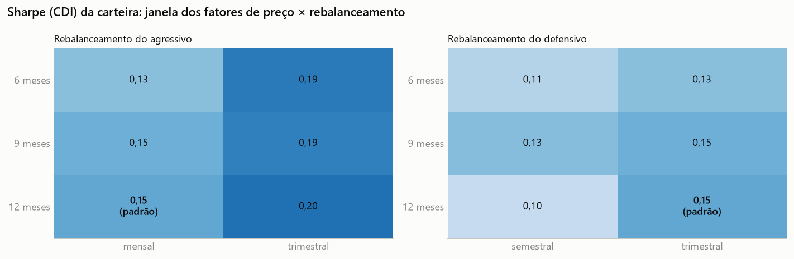

# Robustez (Aula 3)

Gerado por `python src/robustez.py`. Período 03/01/2011 a 23/10/2026 (15,8 anos); custo de 0,2% por operação. Estratégia congelada (P20): nada aqui muda o padrão nem escolhe parâmetros.

## 1. Tearsheets do QuantStats

rf fixo = CDI médio do período (10,09% a.a.), porque o HTML do QuantStats não aceita a série diária. O Sharpe oficial é o nosso, com CDI diário.

| série | arquivo | Sharpe QuantStats (rf fixo) | Sharpe nosso (CDI diário) |
|---|---|---|---|
| Estratégia 65/35 | 1_tearsheet_65-35.html | 0,15 | 0,15 |
| Bloco defensivo | 1_tearsheet_defensivo.html | 0,21 | 0,21 |
| Bloco agressivo | 1_tearsheet_agressivo.html | 0,04 | 0,04 |

## 2. Ganhou do CDI?

| ano | Estratégia 65/35 | Bloco defensivo | Bloco agressivo | Ibovespa |
|---|---|---|---|---|
| 2011 | −14,0% | −11,3% | −19,0% | −29,7% |
| 2012 | 4,0% | −2,5% | 16,2% | −1,0% |
| 2013 | −12,2% | −11,1% | −14,3% | −23,5% |
| 2014 | −7,6% | −6,8% | −9,3% | −13,7% |
| 2015 | −20,8% | −20,1% | −22,6% | −26,5% |
| 2016 | 16,4% | 20,7% | 8,1% | 24,9% |
| 2017 | 26,9% | 12,6% | 55,8% | 16,9% |
| 2018 | 14,8% | 25,7% | −3,7% | 8,6% |
| 2019 | 45,5% | 41,9% | 52,3% | 26,0% |
| 2020 | −6,2% | −7,4% | −6,4% | 0,1% |
| 2021 | −16,2% | −15,6% | −19,2% | −16,5% |
| 2022 | −2,7% | 9,2% | −22,9% | −7,4% |
| 2023 | 1,8% | 3,6% | −3,4% | 8,9% |
| 2024 | −21,4% | −15,9% | −31,6% | −21,2% |
| 2025 | 23,9% | 25,1% | 21,1% | 19,6% |
| 2026 | 8,8% | 10,8% | 4,6% | 15,8% |
| CAGR − CDI (período todo) | 1,13% | 2,37% | −2,11% | −2,82% |
| anos acima do CDI | 8 de 16 | 8 de 16 | 6 de 16 | 8 de 16 |

## 3. Subperíodos: CAGR

| subperíodo | Estratégia 65/35 | Bloco defensivo | Bloco agressivo | Ibovespa | CDI |
|---|---|---|---|---|---|
| 2011-14 | 2,1% | 1,8% | 2,4% | −7,9% | 9,7% |
| 2015-16 (recessão) | 9,8% | 12,1% | 5,2% | 9,8% | 13,7% |
| 2017-19 | 36,1% | 33,9% | 39,3% | 24,5% | 7,5% |
| 2020 (Covid) | −3,4% | −4,7% | −3,7% | 2,9% | 2,8% |
| 2021-22 (alta de juros) | −1,6% | 3,9% | −12,8% | −4,0% | 8,4% |
| 2023-26 | 15,1% | 18,2% | 8,6% | 17,8% | 13,1% |

### Vol

| subperíodo | Estratégia 65/35 | Bloco defensivo | Bloco agressivo | Ibovespa | CDI |
|---|---|---|---|---|---|
| 2011-14 | 16,8% | 17,9% | 17,2% | 23,1% | 0,1% |
| 2015-16 (recessão) | 19,4% | 20,6% | 19,4% | 25,1% | 0,1% |
| 2017-19 | 17,2% | 16,1% | 21,8% | 19,8% | 0,1% |
| 2020 (Covid) | 41,5% | 38,3% | 51,9% | 44,6% | 0,1% |
| 2021-22 (alta de juros) | 20,3% | 19,4% | 26,6% | 21,0% | 0,3% |
| 2023-26 | 16,4% | 15,1% | 21,3% | 16,4% | 0,1% |

### Max DD

| subperíodo | Estratégia 65/35 | Bloco defensivo | Bloco agressivo | Ibovespa | CDI |
|---|---|---|---|---|---|
| 2011-14 | −18,9% | −19,5% | −24,9% | −37,2% | 0,0% |
| 2015-16 (recessão) | −21,3% | −23,0% | −20,2% | −35,4% | 0,0% |
| 2017-19 | −21,1% | −20,0% | −23,5% | −20,4% | 0,0% |
| 2020 (Covid) | −43,7% | −37,9% | −55,7% | −46,8% | 0,0% |
| 2021-22 (alta de juros) | −22,0% | −17,1% | −41,2% | −26,5% | 0,0% |
| 2023-26 | −18,5% | −16,3% | −29,9% | −16,3% | 0,0% |

## 4. Grades de parâmetros

| grade | valor |
|---|---|
| combinações | 12 |
| Sharpe do padrão | 0,15 |
| Sharpe mínimo / mediano / máximo | 0,10 / 0,15 / 0,20 |
| combinações com Sharpe > 0 | 12 de 12 |
| CAGR mínimo / máximo | 9,83% / 12,05% |
| combinações com CAGR acima do CDI | 11 de 12 |

### Janela × rebalanceamento do agressivo

| janela (meses) | rebalanceamento | Sharpe | CAGR | Max DD | Vol |
|---|---|---|---|---|---|
| 6 | mensal | 0,13 | 10,60% | −45,3% | 20,1% |
| 6 | trimestral | 0,19 | 11,88% | −43,7% | 20,0% |
| 9 | mensal | 0,15 | 10,90% | −44,5% | 20,0% |
| 9 | trimestral | 0,19 | 11,78% | −43,5% | 20,0% |
| 12 | mensal | 0,15 | 11,06% | −43,7% | 20,0% |
| 12 | trimestral | 0,20 | 12,05% | −41,9% | 20,0% |

### Janela × rebalanceamento do defensivo

| janela (meses) | rebalanceamento | Sharpe | CAGR | Max DD | Vol |
|---|---|---|---|---|---|
| 6 | trimestral | 0,13 | 10,60% | −45,3% | 20,1% |
| 6 | semestral | 0,11 | 10,08% | −45,3% | 20,1% |
| 9 | trimestral | 0,15 | 10,90% | −44,5% | 20,0% |
| 9 | semestral | 0,13 | 10,65% | −44,5% | 19,9% |
| 12 | trimestral | 0,15 | 11,06% | −43,7% | 20,0% |
| 12 | semestral | 0,10 | 9,83% | −43,7% | 20,0% |

## 5. Fatias ±10 p.p. (uma de cada vez)

| fatia | valor | Sharpe | CAGR | Max DD | Vol |
|---|---|---|---|---|---|
| padrão | — | 0,15 | 11,06% | −43,7% | 20,0% |
| Quality + Low Vol (defensivo) | 30% → 20% | 0,17 | 11,50% | −41,2% | 19,8% |
| Quality + Low Vol (defensivo) | 30% → 40% | 0,13 | 10,58% | −46,7% | 20,5% |
| Value (defensivo) | 50% → 40% | 0,17 | 11,48% | −45,3% | 20,6% |
| Value (defensivo) | 50% → 60% | 0,14 | 10,73% | −43,2% | 19,7% |
| Size + Momentum (agressivo) | 30% → 20% | 0,16 | 11,21% | −43,0% | 20,2% |
| Size + Momentum (agressivo) | 30% → 40% | 0,15 | 11,02% | −43,3% | 19,9% |

## 6. Piso de volume no agressivo (teste, NÃO candidato)

O custo de 0,2% subestima o custo das ações menos líquidas (spread e impacto maiores): este resultado é otimista.

| medida | Top 90 (padrão) | Piso de R$ 1 mi/dia (real) |
|---|---|---|
| carteira: CAGR | 11,06% | 12,65% |
| carteira: Sharpe | 0,15 | 0,23 |
| carteira: Max DD | −43,7% | −44,4% |
| agressivo: CAGR | 7,82% | 11,98% |
| agressivo: Sharpe | 0,04 | 0,20 |
| agressivo: Max DD | −55,7% | −57,3% |
| agressivo: giro médio/mês | 47% | 42% |
| volume mediano das escolhidas (R$ mi/dia, média das datas) | 55,3 | 6,7 |
| idem, 2011-14 | 20,9 | 3,8 |

| ano (média) | piso (R$ mil/dia nominais) | universo com piso | universo top 90 |
|---|---|---|---|
| 2010 | 412 | 182 | 84 |
| 2011 | 429 | 184 | 84 |
| 2012 | 452 | 177 | 85 |
| 2013 | 480 | 173 | 85 |
| 2014 | 510 | 166 | 85 |
| 2015 | 555 | 149 | 86 |
| 2016 | 605 | 140 | 85 |
| 2017 | 628 | 156 | 86 |
| 2018 | 650 | 163 | 86 |
| 2019 | 674 | 168 | 86 |
| 2020 | 696 | 191 | 87 |
| 2021 | 750 | 238 | 86 |
| 2022 | 823 | 235 | 86 |
| 2023 | 861 | 219 | 86 |
| 2024 | 899 | 209 | 85 |
| 2025 | 944 | 194 | 86 |
| 2026 | 981 | 185 | 86 |

## 7. Quantos anos de dado seriam necessários?

Regra: t ≈ Sharpe × √anos; para 95% de confiança, anos ≥ (1,96 / Sharpe)².

| série | Sharpe (CDI) | t ≈ Sharpe × √anos | anos necessários (95%) | anos que temos |
|---|---|---|---|---|
| Estratégia 65/35 | 0,15 | 0,61 | 165 | 15,8 |
| Bloco defensivo | 0,21 | 0,83 | 88 | 15,8 |
| Bloco agressivo | 0,04 | 0,16 | 2275 | 15,8 |

