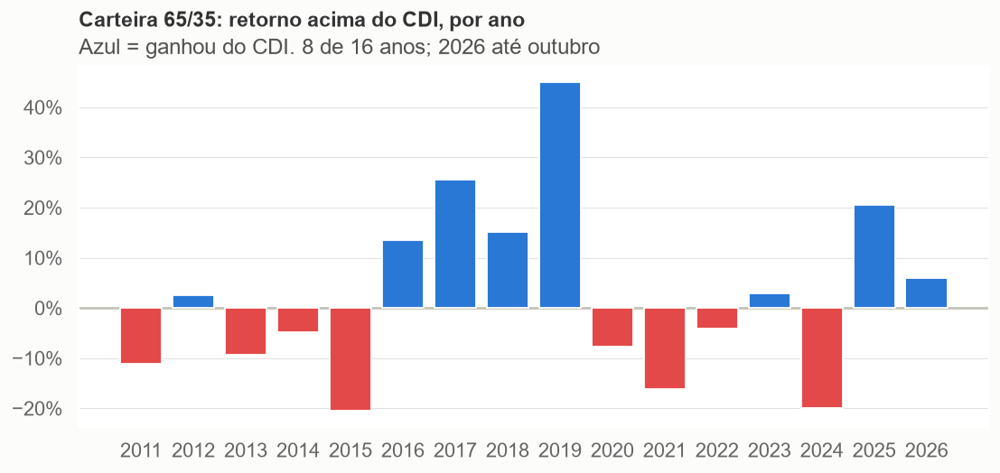
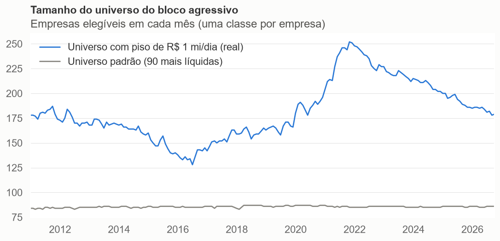

# Robustez (Aula 3)

Gerado por `python src/robustez.py`. Período 03/01/2011 a 23/10/2026 (15,8 anos); custo de 0,2% por operação. Estratégia congelada (P20): nada aqui muda o padrão nem escolhe parâmetros.

## 1. Tearsheets do QuantStats

rf fixo = CDI médio do período (10,09% a.a.), porque o HTML do QuantStats não aceita a série diária. O Sharpe oficial é o nosso, com CDI diário.

| série | arquivo | Sharpe QuantStats (rf fixo) | Sharpe nosso (CDI diário) |
|---|---|---|---|
| Estratégia 65/35 | 1_tearsheet_65-35.html | 0,15 | 0,15 |
| Bloco defensivo | 1_tearsheet_defensivo.html | 0,21 | 0,21 |
| Bloco agressivo | 1_tearsheet_agressivo.html | 0,04 | 0,04 |

## 2. Ganhou do CDI?

| ano | Estratégia 65/35 | Bloco defensivo | Bloco agressivo | Ibovespa |
|---|---|---|---|---|
| 2011 | −11,1% | −6,6% | −19,1% | −29,7% |
| 2012 | 2,5% | −4,6% | 16,2% | −1,0% |
| 2013 | −9,4% | −6,7% | −14,3% | −23,5% |
| 2014 | −4,9% | −3,7% | −7,6% | −13,7% |
| 2015 | −20,5% | −20,0% | −22,0% | −26,5% |
| 2016 | 13,6% | 16,4% | 8,3% | 24,9% |
| 2017 | 25,5% | 10,7% | 55,8% | 16,9% |
| 2018 | 15,1% | 26,2% | −3,7% | 8,6% |
| 2019 | 45,0% | 41,1% | 52,3% | 26,0% |
| 2020 | −7,7% | −9,7% | −6,4% | 0,1% |
| 2021 | −16,2% | −15,6% | −19,2% | −16,5% |
| 2022 | −4,1% | 6,9% | −22,9% | −7,4% |
| 2023 | 2,9% | 5,3% | −3,4% | 8,9% |
| 2024 | −20,0% | −13,6% | −31,6% | −21,2% |
| 2025 | 20,4% | 21,8% | 17,4% | 19,6% |
| 2026 | 5,9% | 6,7% | 4,1% | 15,8% |
| CAGR − CDI (período todo) | 1,05% | 2,29% | −2,16% | −2,82% |
| anos acima do CDI | 8 de 16 | 8 de 16 | 6 de 16 | 8 de 16 |

## 3. Subperíodos: CAGR

| subperíodo | Estratégia 65/35 | Bloco defensivo | Bloco agressivo | Ibovespa | CDI |
|---|---|---|---|---|---|
| 2011-14 | 3,9% | 4,3% | 2,8% | −7,9% | 9,7% |
| 2015-16 (recessão) | 8,8% | 10,3% | 5,7% | 9,8% | 13,7% |
| 2017-19 | 35,6% | 33,1% | 39,3% | 24,5% | 7,5% |
| 2020 (Covid) | −5,0% | −6,9% | −3,7% | 2,9% | 2,8% |
| 2021-22 (alta de juros) | −2,3% | 2,9% | −12,8% | −4,0% | 8,4% |
| 2023-26 | 14,4% | 17,6% | 7,6% | 17,8% | 13,1% |

### Vol

| subperíodo | Estratégia 65/35 | Bloco defensivo | Bloco agressivo | Ibovespa | CDI |
|---|---|---|---|---|---|
| 2011-14 | 16,6% | 17,6% | 17,1% | 23,1% | 0,1% |
| 2015-16 (recessão) | 19,2% | 20,2% | 19,5% | 25,1% | 0,1% |
| 2017-19 | 17,2% | 16,1% | 21,8% | 19,8% | 0,1% |
| 2020 (Covid) | 41,6% | 38,3% | 51,9% | 44,6% | 0,1% |
| 2021-22 (alta de juros) | 20,2% | 19,4% | 26,6% | 21,0% | 0,3% |
| 2023-26 | 16,6% | 15,4% | 21,3% | 16,4% | 0,1% |

### Max DD

| subperíodo | Estratégia 65/35 | Bloco defensivo | Bloco agressivo | Ibovespa | CDI |
|---|---|---|---|---|---|
| 2011-14 | −18,9% | −19,4% | −24,7% | −37,2% | 0,0% |
| 2015-16 (recessão) | −20,9% | −22,7% | −19,7% | −35,4% | 0,0% |
| 2017-19 | −19,7% | −18,4% | −23,5% | −20,4% | 0,0% |
| 2020 (Covid) | −45,3% | −39,8% | −55,7% | −46,8% | 0,0% |
| 2021-22 (alta de juros) | −22,0% | −17,1% | −41,2% | −26,5% | 0,0% |
| 2023-26 | −18,4% | −14,7% | −29,9% | −16,3% | 0,0% |

| comparação | subperíodos (empate = diferença < 0,1 p.p.) |
|---|---|
| carteira x Ibovespa | bate em 3, empata em 0, perde em 3 de 6 |
| carteira x CDI | bate em 2, empata em 0, perde em 4 de 6 |

## 4. Grades de parâmetros

**Atenção:** todas as combinações usam os mesmos dados e o mesmo período. Elas mostram se o resultado depende de um parâmetro específico, mas NÃO são evidências independentes: nove Sharpes parecidos não valem como nove testes.

| grade | valor |
|---|---|
| combinações distintas | 9 (as 3 do rebalanceamento padrão aparecem nas duas grades) |
| Sharpe do padrão | 0,15 |
| Sharpe mínimo / mediano / máximo | 0,11 / 0,17 / 0,23 |
| combinações com Sharpe > 0 | 9 de 9 |
| CAGR mínimo / máximo | 10,16% / 12,87% |
| combinações com CAGR acima do CDI | 9 de 9 |

### Janela × rebalanceamento do agressivo

| janela (meses) | rebalanceamento | freq. agressivo | freq. defensivo | Sharpe | CAGR | Max DD | Vol |
|---|---|---|---|---|---|---|---|
| 6 | mensal | mensal | trimestral | 0,17 | 11,42% | −45,7% | 20,0% |
| 6 | trimestral | trimestral | trimestral | 0,23 | 12,87% | −44,1% | 20,0% |
| 9 | mensal | mensal | trimestral | 0,17 | 11,35% | −46,2% | 20,0% |
| 9 | trimestral | trimestral | trimestral | 0,22 | 12,45% | −45,2% | 20,0% |
| 12 | mensal | mensal | trimestral | 0,15 | 10,98% | −45,3% | 20,0% |
| 12 | trimestral | trimestral | trimestral | 0,20 | 12,08% | −43,6% | 19,9% |

### Janela × rebalanceamento do defensivo

| janela (meses) | rebalanceamento | freq. agressivo | freq. defensivo | Sharpe | CAGR | Max DD | Vol |
|---|---|---|---|---|---|---|---|
| 6 | trimestral | mensal | trimestral | 0,17 | 11,42% | −45,7% | 20,0% |
| 6 | semestral | mensal | semestral | 0,13 | 10,57% | −45,7% | 20,1% |
| 9 | trimestral | mensal | trimestral | 0,17 | 11,35% | −46,2% | 20,0% |
| 9 | semestral | mensal | semestral | 0,14 | 10,88% | −46,2% | 20,0% |
| 12 | trimestral | mensal | trimestral | 0,15 | 10,98% | −45,3% | 20,0% |
| 12 | semestral | mensal | semestral | 0,11 | 10,16% | −45,3% | 20,0% |

## 5. Fatias ±10 p.p. (uma de cada vez)

| fatia | valor | Sharpe | CAGR | Max DD | Vol |
|---|---|---|---|---|---|
| padrão | — | 0,15 | 10,98% | −45,3% | 20,0% |
| Quality + Low Vol (defensivo) | 30% → 20% | 0,16 | 11,30% | −43,2% | 19,8% |
| Quality + Low Vol (defensivo) | 30% → 40% | 0,14 | 10,84% | −48,1% | 20,5% |
| Value (defensivo) | 50% → 40% | 0,16 | 11,24% | −46,5% | 20,7% |
| Value (defensivo) | 50% → 60% | 0,14 | 10,88% | −44,2% | 19,7% |
| Size + Momentum (agressivo) | 30% → 20% | 0,15 | 10,94% | −44,6% | 20,1% |
| Size + Momentum (agressivo) | 30% → 40% | 0,15 | 10,93% | −44,9% | 19,9% |

## 6. Piso de volume no agressivo (teste, NÃO candidato)

O custo de 0,2% subestima o custo das ações menos líquidas (spread e impacto maiores): este resultado é otimista.

| medida | Top 90 (padrão) | Piso de R$ 1 mi/dia (real) |
|---|---|---|
| carteira: CAGR | 10,98% | 12,57% |
| carteira: Sharpe | 0,15 | 0,22 |
| carteira: Max DD | −45,3% | −46,0% |
| agressivo: CAGR | 7,77% | 11,93% |
| agressivo: Sharpe | 0,04 | 0,20 |
| agressivo: Max DD | −55,7% | −57,3% |
| agressivo: giro médio/mês | 46% | 42% |
| volume mediano das escolhidas (R$ mi/dia, média das datas) | 55,0 | 6,8 |
| idem, 2011-14 | 20,8 | 3,9 |

| ano (média) | piso (R$ mil/dia nominais) | universo com piso | universo top 90 |
|---|---|---|---|
| 2010 | 412 | 178 | 84 |
| 2011 | 429 | 179 | 84 |
| 2012 | 452 | 173 | 85 |
| 2013 | 480 | 170 | 85 |
| 2014 | 510 | 163 | 85 |
| 2015 | 555 | 146 | 86 |
| 2016 | 605 | 137 | 85 |
| 2017 | 628 | 154 | 86 |
| 2018 | 650 | 161 | 86 |
| 2019 | 674 | 167 | 86 |
| 2020 | 696 | 190 | 87 |
| 2021 | 750 | 236 | 86 |
| 2022 | 823 | 234 | 86 |
| 2023 | 861 | 218 | 86 |
| 2024 | 899 | 208 | 85 |
| 2025 | 944 | 192 | 86 |
| 2026 | 981 | 183 | 86 |

## 7. Quantos anos de dado seriam necessários?

Regra: t ≈ Sharpe × √anos; para 95% de confiança, anos ≥ (1,96 / Sharpe)².

| série | Sharpe (CDI) | t ≈ Sharpe × √anos | anos necessários (95%) | anos que temos |
|---|---|---|---|---|
| Estratégia 65/35 | 0,15 | 0,59 | 173 | 15,8 |
| Bloco defensivo | 0,21 | 0,82 | 91 | 15,8 |
| Bloco agressivo | 0,04 | 0,16 | 2500 | 15,8 |

### Intervalo do Sharpe e t do alpha

Erro-padrão do Sharpe ≈ √((1 + SR²/2) / anos). Alpha = intercepto da regressão do excesso diário sobre o CDI contra o excesso do Ibovespa, anualizado (× 252). t com Newey-West.

| série | Sharpe (CDI) | intervalo de 95% do Sharpe | alpha anual | t do alpha (Newey-West) | excesso médio sobre o Ibovespa (a.a.) | t do excesso sobre o Ibovespa | defasagens (NW) |
|---|---|---|---|---|---|---|---|
| Estratégia 65/35 | 0,15 | −0,35 a 0,64 | 2,94% | 1,42 | 2,93% | 1,28 | 9 |
| Bloco defensivo | 0,21 | −0,29 a 0,70 | 3,95% | 1,73 | 3,93% | 1,50 | 9 |
| Bloco agressivo | 0,04 | −0,45 a 0,53 | 0,91% | 0,27 | 0,90% | 0,27 | 9 |

### CAGR sem 2017-19

| CAGR | Estratégia 65/35 | Bloco defensivo | Bloco agressivo | Ibovespa | CDI |
|---|---|---|---|---|---|
| período todo | 10,98% | 12,22% | 7,77% | 7,11% | 9,93% |
| sem 2017-19 | 5,92% | 7,84% | 1,51% | 3,41% | 10,52% |

